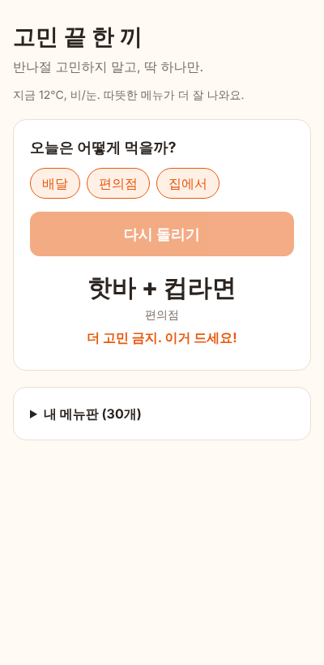
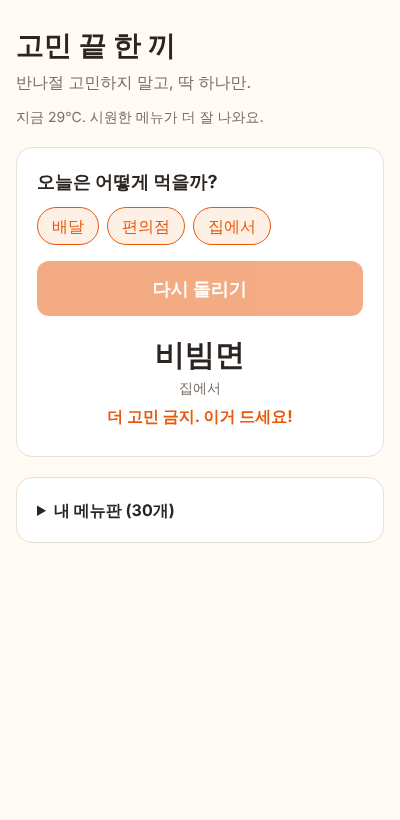
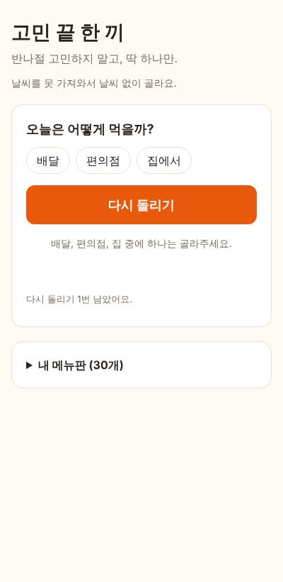

# 고민 끝 한 끼

**배포 주소**: https://joshua4949858.github.io/bapgomin/

메뉴를 못 정하는 사람을 위해 **딱 하나만 정해주는** 웹페이지입니다.

## 왜 만들었나, 누가 쓰나

저는 혼자 사는데, 밥 먹을 때마다 메뉴를 못 정해서 반나절 고민하다가 결국 라면을 먹거나 그냥 자버릴 때가 많습니다. 배달 앱 장바구니에 넣었다 뺐다를 반복하고, 편식도 하고, 음식물 쓰레기 남는 것도 싫어서 고르기가 더 어렵습니다.

그래서 대상 사용자는 **저처럼 결정을 잘 못 하는 1인 가구**입니다. 계획을 세워 주는 앱이 아니라, 그 자리에서 "이거 먹어"라고 끝내 주는 도구가 목표입니다.

## 기능

- **내 메뉴판**: 기본으로 30개 메뉴가 들어 있고, 내가 실제로 먹는 메뉴만 남기거나 추가합니다 (배달 / 편의점 / 집에서). 싫어하는 건 지우면 안 나옵니다.
- **자동 분류**: 메뉴 이름을 치면 종류와 날씨 성향을 알아서 채웁니다. 예를 들어 "순대국"은 배달 · 따뜻한 거, "컵라면"은 편의점 · 따뜻한 거가 됩니다. 틀리면 직접 바꾸면 되고, 직접 바꾼 값이 우선합니다.
- **날씨 반영**: 현재 위치 날씨를 가져와서 비 오거나 10°C 미만이면 따뜻한 메뉴, 25°C 이상이면 시원한 메뉴가 3배 더 잘 나옵니다.
- **다시 돌리기 2번 제한**: 세 번째 결과에서 "더 고민 금지. 이거 드세요!"로 끝납니다. 장바구니 넣었다 빼는 습관을 막는 장치입니다.

| 비 오는 날 | 더운 날 | 예외 상황 |
|---|---|---|
|  |  |  |

## 실행 방법

- **그냥 쓰기**: 위 배포 주소를 열고, 위치 권한을 허용한 뒤 "골라줘"를 누르면 됩니다.
- **내 컴퓨터에서 실행**: 빌드 과정이 없는 HTML/JS라 정적 서버만 있으면 됩니다.
  ```bash
  python3 -m http.server 8000   # http://localhost:8000 접속
  ```
- **테스트**: Node.js 18 이상에서 `npm test` (설치할 패키지 없음)

메뉴판과 설정은 브라우저 저장소(localStorage)에만 저장되고 서버나 로그인은 없습니다. 날씨는 [Open-Meteo](https://open-meteo.com/)를 쓰는데 API 키가 필요 없어서 저장소에 비밀 정보가 없습니다.

## 채점용 핵심 파일 (5개)

1. `picker.js` — 메뉴 고르는 규칙 (날씨 성향, 가중치 추첨, 이미 나온 메뉴 빼기, 이름으로 자동 분류)
2. `weather.js` — 위치와 날씨 불러오기, 실패하면 대체
3. `app.js` — 화면 동작 (룰렛, 다시 돌리기 제한, 메뉴판 편집, 저장)
4. `index.html` — 화면 구조
5. `tests/picker.test.js` — 고르기 규칙 테스트

## 작업 과정

1. **주제 정하기**가 제일 오래 걸렸습니다. Claude가 가계부 분석기, 일정 조율기를 먼저 추천했지만 저는 토스를 쓰고 계획을 안 지키는 편이라 안 맞았습니다. "오늘 뭐 먹지"는 흔해서 겹칠까 걱정했는데, 제 식습관(배달 위주, 편의점, 결정장애, 편식)을 길게 설명했더니 "다시 돌리기 2번 제한"처럼 제 상황에 맞는 아이디어가 나왔습니다.
2. **범위 정하기**: 혼자서 끝까지 만들 수 있게 서버, 로그인, API 키가 필요 없는 구조로 정했습니다. 날씨 API도 키가 필요 없는 Open-Meteo를 골랐습니다.
3. **구현**: 고르는 규칙(`picker.js`)을 화면과 분리해서 먼저 만들고 테스트를 붙인 뒤, 날씨와 화면을 붙였습니다. 기능 단위로 커밋했습니다.
4. **확인과 수정**: 브라우저 자동 테스트로 비 / 더위 / 날씨 실패 상황을 돌려 보다가 날씨 실패 시 안내 문구가 두 번 나오는 버그를 찾아 고쳤습니다.
5. **배포**: GitHub Pages로 배포했습니다.
6. **직접 써보고 개선**: 배포 사이트를 써보니 기본 메뉴가 9개라 종류가 적었습니다. 기본 메뉴를 30개로 늘리고, 직접 추가한 메뉴도 종류와 성향이 알아서 정해지면 좋겠다고 생각해서 이름으로 자동 분류하는 기능을 넣었습니다.

### Claude Code 작업 발췌

실제 대화를 짧게 줄여 옮겼습니다.

> **나**: 나는 결정을 못 해서 반나절 고민하다 라면 먹거나 자버려. 장바구니 넣었다 빼는 것도 많고 편식도 하고 음식물 쓰레기도 싫어.
> **Claude**: 진짜 문제는 메뉴를 모르는 게 아니라 못 정하는 것이네요. 다시 돌리기를 2번까지만 허용하고 3번째엔 확정하는 장치를 넣어볼게요.

> **Claude (확인 결과)**: 날씨를 못 가져왔을 때 "날씨 상관없이 골라요. 날씨를 못 가져와서 날씨 없이 골라요."처럼 문구가 겹쳐 나와서, 날씨가 없을 때는 앞 문장을 빼도록 고쳤습니다.

> **Claude (환경 문제)**: 이 작업 환경에서는 Open-Meteo 접속이 막혀 있어서, 테스트에서는 날씨 응답을 가짜로 넣어 비 / 더위 / 실패 상황을 확인했습니다.

## 검증 결과

| 확인한 것 | 방법 | 결과 |
|---|---|---|
| 날씨 → 성향 판단 (비, 추위, 더위, 보통, 날씨 없음) | `npm test` | 통과 |
| 따뜻한 날 따뜻한 메뉴가 더 자주 나옴 | 4,000번 뽑아 계산한 기대 비율과 비교 | 오차 4% 이내로 통과 |
| 고른 종류만, 이미 나온 메뉴는 다시 안 나옴 | `npm test` | 통과 |
| 이름으로 자동 분류 (헷갈리는 이름 포함 9개) | `npm test` | 통과 |
| 비 오는 날 화면 | 브라우저 자동 테스트 (날씨 응답 가짜 입력) | 따뜻한 메뉴 안내, 3번째에 확정, 버튼 잠김 |
| 더운 날 화면 | 같은 방법 | 시원한 메뉴 안내 |
| **예외**: 위치 거부 + 날씨 실패 | 같은 방법 | 날씨 없이 정상으로 골라줌 |
| **예외**: 후보가 다 떨어짐 / 종류를 하나도 안 고름 | 같은 방법 | 안내 문구 표시, 오류 없음 |
| **엣지**: "탕수육", "냉동만두"처럼 글자만 보면 헷갈리는 이름 | `npm test` | 예외 처리로 "상관없음"으로 분류 |
| 배포 사이트 접속과 실제 날씨 | 직접 열어봄 | 정상 접속, 맨 위에 현재 기온 표시됨 (배포 직후 잠깐 404가 떴다가 1~2분 뒤 열림) |

## 효과적이었던 방법 3가지

1. **내 상황을 구체적으로 길게 말하기**: "뭐 만들지 추천해줘"보다 제 식습관을 자세히 말했을 때 훨씬 맞는 아이디어가 나왔습니다.
2. **규칙과 화면을 나눠서 테스트하기**: 고르는 규칙을 따로 떼어 두니 랜덤인데도 결과를 고정해서 테스트할 수 있었습니다.
3. **예외 상황을 일부러 만들어 보기**: 위치 거부, 날씨 실패, 메뉴 없음을 직접 돌려 봐서 문구 중복 버그를 찾았습니다.

## 어려웠던 점 3가지

1. **주제 고르기**: 추천받은 주제가 제 생활과 안 맞아서 여러 번 거절했고 시간이 많이 들었습니다. 결국 제 습관을 자세히 설명하는 걸로 해결했습니다.
2. **GitHub 권한 설정**: 처음에 아이디/비번을 주면 되는 줄 알았는데, 계정 연결 → Claude 앱 설치 → Pages 설정을 제가 직접 해야 했습니다. 단계마다 막혀서 답답했지만 하나씩 따라 해서 해결했습니다.
3. **AI 작업 환경에서 날씨 API가 막힘**: Claude 쪽 환경에서는 날씨 서버와 배포 사이트에 접속할 수 없어서, 테스트는 날씨 응답을 가짜로 넣어서 했고, 실제 날씨가 뜨는지는 배포 사이트를 직접 열어서 확인하는 방식으로 대응했습니다.

## 알려진 한계

- 다시 돌리기 제한은 **새로고침하면 초기화**됩니다. 마음먹으면 우회할 수 있습니다.
- 메뉴판은 **이 브라우저에만** 저장돼서 폰과 컴퓨터가 따로 놉니다.
- 위치를 거부하면 **서울 날씨 기준**으로 고릅니다.
- 자동 분류는 이름에 든 글자(국, 탕, 냉, 컵라면 등)만 보는 단순 규칙이라 처음 보는 메뉴는 "배달 · 상관없음"으로 들어갑니다.
- 날씨는 기온과 비/눈 여부만 봅니다. 시간대(아침/야식)나 실제 가게 영업 여부는 모릅니다.
- 기본 메뉴판 30개는 예시라서 처음 쓸 때 안 먹는 건 지워야 합니다.
